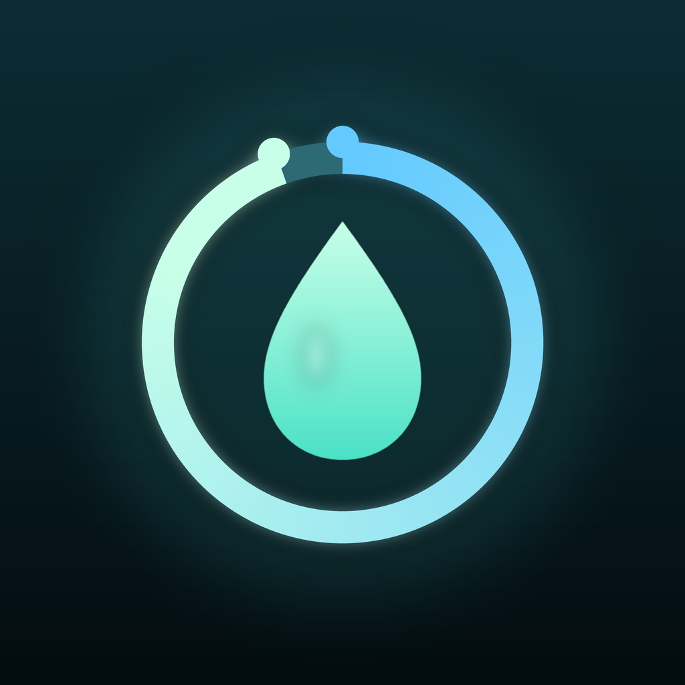
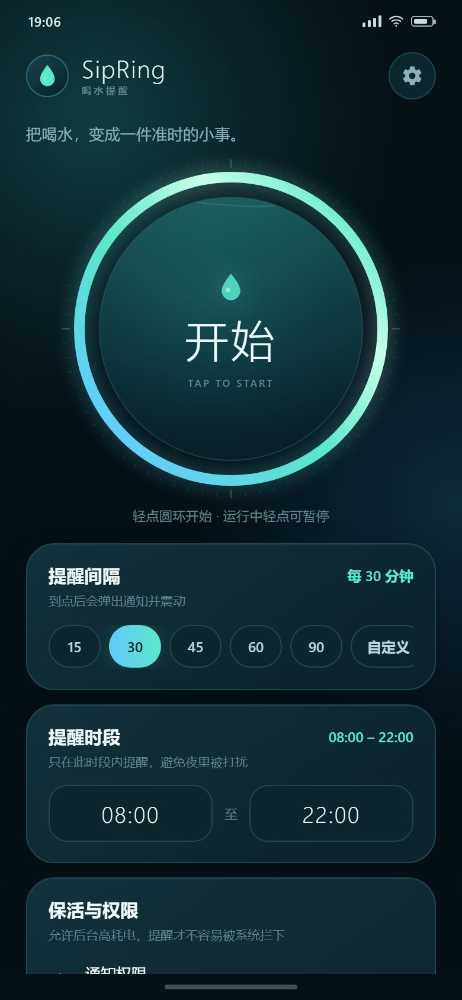
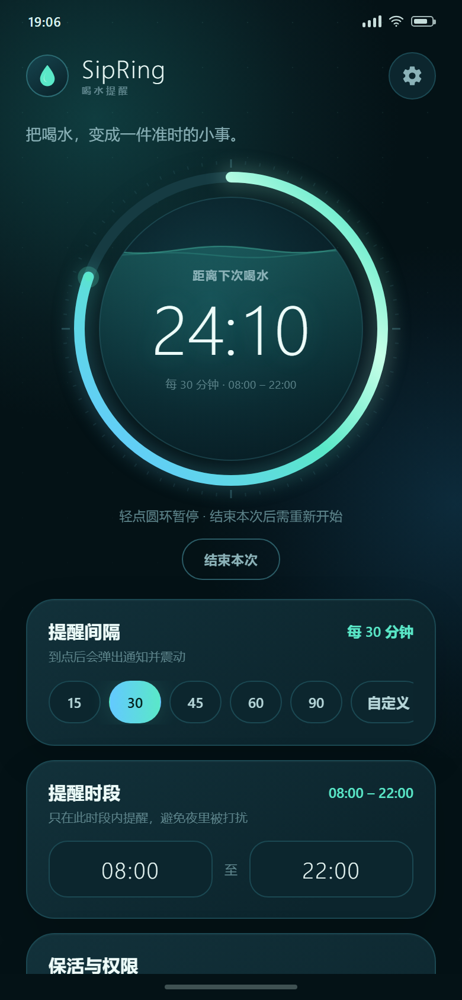
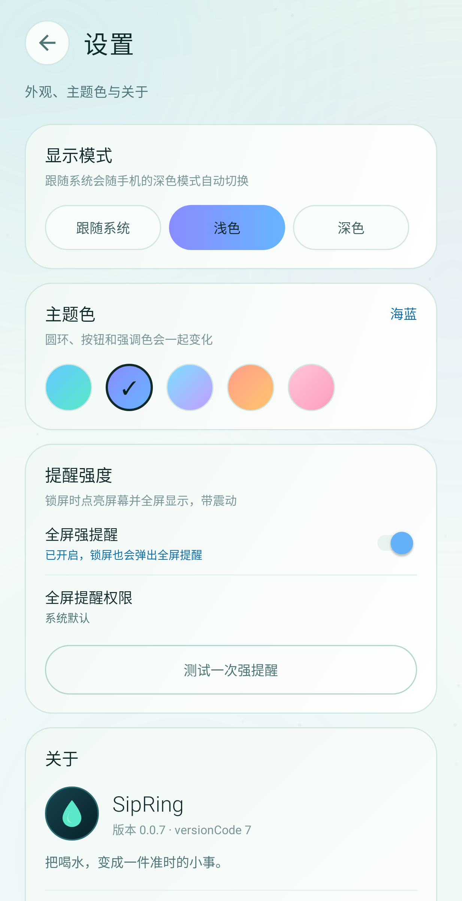
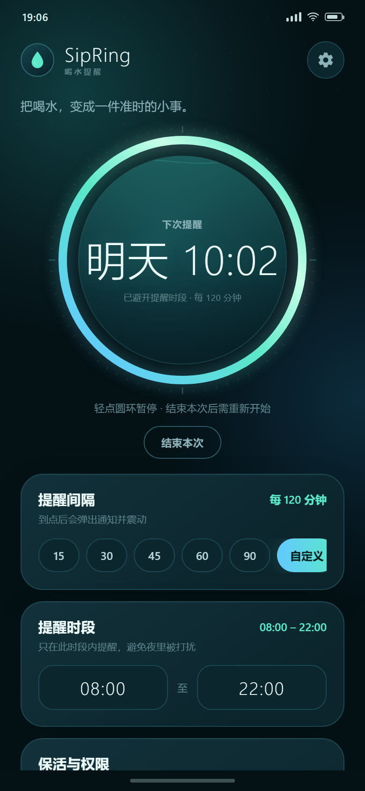
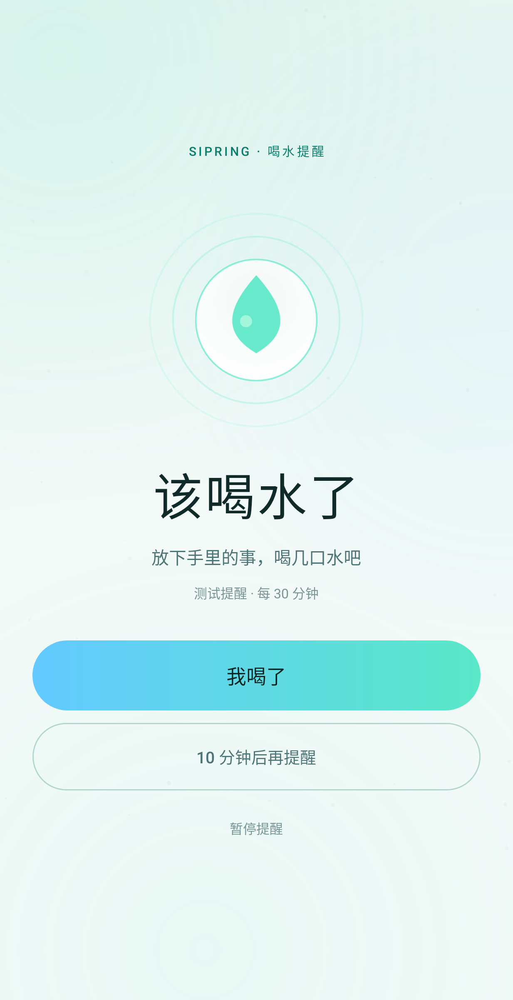

# SipRing · 喝水提醒

> **v0.0.7** · 一个会认真提醒你喝水的小应用。  
> Android 8.0+（minSdk 26）· 原生 Java · 无网络权限 · 无第三方 UI 依赖

<p align="center">
  
</p>

<p align="center">
  
  &nbsp;&nbsp;
  
  &nbsp;&nbsp;
  
</p>

<p align="center">
  <sub>待机 · 运行中 · 设置（浅色 + 海蓝主题，390 × 844 互动设计预览）</sub>
</p>

---

## 这是什么

SipRing 只做一件事：在你设定的时间间隔和时段里，用通知提醒你喝水。

主界面只有一个大圆环。轻点开始，圆环变成倒计时；再点一下暂停；点「结束本次」完全停止。提醒间隔和时段在主界面设置，右上角齿轮进入外观、主题色与关于页面。

## 功能

| 功能 | 说明 |
| --- | --- |
| 圆形主按钮 | 轻点开始 / 暂停 / 继续，带水波进度、渐变光环和实时倒计时 |
| 自定义间隔 | 1–180 分钟；快捷 15 / 30 / 45 / 60 / 90，或输入自定义值 |
| 自定义时段 | 例如 08:00–22:00；开始时间 = 结束时间时表示全天 |
| 通知提醒 | 高优先级通知 + 震动；通知上可直接「我喝了」或「暂停」 |
| 全屏强提醒 | 锁屏时点亮屏幕并全屏显示「该喝水了」，持续震动，带稍后 10 分钟 |
| 强提醒控制 | 设置里可开关全屏强提醒、查看 Android 14 权限、发送测试提醒 |
| 常驻计时通知 | 前台服务通知实时倒计时，锁屏也能看到剩余时间 |
| 精准闹钟 | Android 12+ 可授权精准闹钟，尽量保证 Doze 下准时 |
| 允许高耗电 | 一键跳转「忽略电池优化」，减少系统拦截 |
| 划掉即停止 | 从最近任务划掉 SipRing 后，计时、闹钟、通知全部停止 |
| 外观设置 | 跟随系统 / 浅色 / 深色，立即切换 |
| 主题色 | 青碧 / 海蓝 / 雾紫 / 暖金 / 玫瑰，圆环、按钮和强调色一起变化 |
| 关于与隐私 | 应用名称、版本号、本地运行隐私声明 |
| 本地存储 | 设置保存在 SharedPreferences，无网络权限，不收集数据 |
| 主题图标 | 自适应图标 + Android 13 单色主题图标 |

## 安装

APK 位于：

```text
dist/SipRing-0.0.7.apk
```

直接下载：[`dist/SipRing-0.0.7.apk`](dist/SipRing-0.0.7.apk)

1. 把 APK 发到手机（微信文件传输、数据线、网盘均可）。
2. 点击安装；如系统提示「禁止未知来源」，允许当前文件管理器安装。
3. 打开 SipRing，按首页「保活与权限」卡片逐项开启：
   - **通知权限**：否则提醒不会显示；
   - **电池优化 → 允许高耗电**：否则部分系统会限制后台；
   - **精准闹钟**：Android 12+ 建议允许，未允许时会退化为近似提醒；
   - **全屏提醒权限**：Android 14+ 在「设置 → 提醒强度」中允许，否则锁屏可能只显示通知；
   - 小米 / OPPO / vivo / 荣耀等机型，再到系统设置里允许「自启动」或「后台运行」。
4. 打开「设置 → 提醒强度」，点「测试一次强提醒」确认全屏页面、震动和主题都正常。
5. 回到首页，轻点圆环开始。

第一次测试时可以把间隔设为 1 分钟，等通知出现后试一下「我喝了」「暂停」和划掉后台，确认厂商系统没有拦截。

也可以使用 adb：

```bash
adb install -r dist/SipRing-0.0.7.apk
```

> APK 使用仓库内的 `keystore/sipring-dev.jks` 开发签名。它可以正常侧载和覆盖升级；如果以后要上架应用商店，请换成自己的私密签名，不要继续使用这个仓库密钥。  
> **公开仓库安全提示**：密钥和密码目前随仓库提供，任何拿到仓库的人都能签出可以被系统当作「同一应用」的更新。如果这个仓库会公开，建议后续把 `keystore.properties` 与 `.jks` 移到 GitHub Secrets，并为新版本更换签名（更换后无法直接覆盖安装旧版本）。

## 行为说明

- **全屏强提醒**：到点后会使用全屏 Intent 点亮屏幕并打开强提醒页面，同时持续震动最多 20 秒。锁屏时直接全屏；未锁屏时系统通常会先显示高亮通知，点开即进入同一页面。
- **应用内任意页面**：即使停留在设置页或其他 SipRing 页面，到点也会直接打开全屏提醒，不再只依赖系统通知。
- **Android 14 全屏权限**：设置页「提醒强度」会显示全屏提醒权限状态，未允许时可点「去允许」。即使未允许，高优先级通知和震动仍会保留。
- **划掉后台会停止**：这是刻意设计。`TimerService.onTaskRemoved()` 会取消计时、取消 AlarmManager 闹钟并清除通知。没有开机自启，也没有「被划掉后偷偷复活」。
- **锁屏 / 息屏**：前台服务保持计时；同时用 `AlarmManager.setExactAndAllowWhileIdle()` 做兜底。部分厂商的省电策略仍可能延迟通知，建议允许高耗电和自启动。
- **重启手机**：没有 BOOT_COMPLETED 接收器，所以重启后不会自动恢复提醒；重新打开 App 即可。这样可以避免「划掉后台后还被唤醒」的歧义。
- **时段边界**：如果下一次提醒落在免打扰时段之外，会顺延到下一个时段开始后再加一个间隔。例如 08:00–22:00、30 分钟，21:50 开始的下一杯会安排在次日 08:30，而不是 22:20。
- **长间隔跨时段**：例如 120 分钟间隔在 20:40 开始，下一次提醒会跨到次日。圆环会显示「下次提醒 · 明天 10:00」和「已避开提醒时段」，不会显示成 13 个多小时的倒计时；进度环按实际等待时长消退。
- **通知权限被拒绝**：计时仍会运行，但系统不会展示提醒；首页会持续显示「未开启」。

### 长间隔显示

当 120 分钟这类长间隔跨到下一个提醒时段时，圆环会显示具体提醒时间，而不是一个容易误以为出错的十几个小时倒计时：

<p align="center">
  
</p>

### 全屏强提醒

到点后可以点亮屏幕并打开大号提醒页，锁屏时也能直接看到：

<p align="center">
  
</p>

## 权限

| 权限 | 用途 |
| --- | --- |
| `POST_NOTIFICATIONS` | Android 13+ 显示喝水提醒和计时通知 |
| `FOREGROUND_SERVICE` / `FOREGROUND_SERVICE_SPECIAL_USE` | 计时前台服务 |
| `WAKE_LOCK` | 提醒触发时短暂唤醒 CPU，保证通知送达 |
| `VIBRATE` | 提醒震动 |
| `SCHEDULE_EXACT_ALARM` | Android 12+ 精准闹钟；拒绝后自动退化为近似闹钟 |
| `REQUEST_IGNORE_BATTERY_OPTIMIZATIONS` | 用户主动点击时申请忽略电池优化 |

没有 `INTERNET` 权限。SipRing 不联网，也不收集任何数据。

## 互动预览

`preview/index.html` 是一个可以直接在浏览器打开的高保真交互预览，用来在没有 Android 设备时检查布局、颜色和交互：

```text
preview/index.html
```

直接打开：[`preview/index.html`](preview/index.html)

- 点击圆环开始 / 暂停；
- 点击快捷间隔或「自定义」；
- 点击时间按钮修改时段；
- 点击权限行可切换演示状态（仅预览）。
- 运行中截图参数：`preview/index.html?state=running&remaining=1453&shot=1`
- 截图使用 Edge headless 生成：`preview/preview-idle.png`、`preview/preview-running.png`。

预览是 Web 实现，不是 APK 内嵌页面；正式 UI 由原生 Canvas / XML 绘制。两者使用同一套颜色、间距和文案。

## 从源码构建

要求：

- JDK 17 或 21
- Android SDK Platform 35
- Build-Tools 35.0.0
- Gradle 8.9（仓库已带 wrapper）

Windows：

```powershell
$env:JAVA_HOME = "C:\path\to\jdk"
$env:ANDROID_HOME = "C:\path\to\Android\Sdk"
.\gradlew.bat assembleRelease
```

macOS / Linux：

```bash
export JAVA_HOME=/path/to/jdk
export ANDROID_HOME=/path/to/Android/Sdk
./gradlew assembleRelease
```

产物：

```text
app/build/outputs/apk/release/app-release.apk
```

输出使用 `keystore.properties` 中配置的签名。仓库内的密钥只用于个人侧载；正式发布前请替换，并把新密钥加入 `.gitignore`。

### GitHub Actions

`.github/workflows/android.yml` 会在 push / PR / 手动触发时构建签名的 Release APK，并上传为 Actions Artifact。仓库里的 `keystore.properties` 和开发密钥让 CI 产物可以直接安装、覆盖升级。公开仓库使用前请阅读上面的密钥警告。

## 项目结构

```text
SipRing/
├─ app/src/main/java/com/sipring/app/
│  ├─ MainActivity.java      主界面、权限、圆环交互
│  ├─ SettingsActivity.java  显示模式、主题色、关于与隐私
│  ├─ ThemeManager.java      主题/主题色选择与系统栏
│  ├─ ThemeColors.java       主题属性取色
│  ├─ TimerService.java      前台服务、计时、通知、AlarmManager
│  ├─ TimerRingView.java     Canvas 绘制的圆形倒计时 / 水波
│  ├─ AuroraView.java        背景光晕
│  ├─ Prefs.java             本地设置与状态
│  └─ TimerSnapshot.java     服务 → UI 的只读状态
├─ app/src/test/             Robolectric 启动回归测试
├─ app/src/main/res/         布局、颜色、图标、主题
├─ preview/                  Web 互动预览与截图
├─ tools/make_icons.py       图标生成脚本
├─ keystore/                 开发签名（仅侧载）
├─ dist/                     构建好的 APK 与校验值
└─ .github/workflows/        CI 构建
```

## 版本

当前版本 **0.0.7**（versionCode `7`）。

更新记录见 [CHANGELOG.md](CHANGELOG.md)。

## 已知限制

- 已用 Robolectric 在 API 26 / 29 / 31 / 33 / 34 上跑过 `MainActivity`、`SettingsActivity` 与 `TimerService` 启动测试；但构建环境没有真机或模拟器，尚未完成真机端到端测试。
- 如果启动阶段遇到平台或厂商异常，0.0.7 会显示「SipRing 启动失败」错误页，而不是直接闪退；可以把错误页截图或「复制错误信息」的内容发回来。
- 部分国产 ROM 会杀掉前台服务。SipRing 已尽量申请所需权限，但最终仍受系统策略影响。
- 应用锁定竖屏，主要针对手机；平板会以竖屏居中显示。
- 0.0.7 用前台服务 + 单次精确闹钟维持计时，没有做 WorkManager 链式补偿。

## 回归测试

```bash
./gradlew testDebugUnitTest
```

测试覆盖 `MainActivity`、`SettingsActivity` 启动，`TimerService` 创建，浅色/深色/强调色主题加载，资源/主题加载和通知渠道创建，运行在 API 26 / 29 / 31 / 33 / 34。

## License

[MIT](LICENSE)


